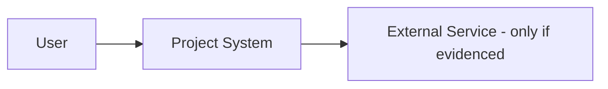

# Architecture — [Project]

> Status: Observed / Proposed · Owner: [role] · Last reviewed: [YYYY-MM-DD]
> Evidence: [repository paths, configs, running systems, ADRs]

## 1. Scope, drivers and constraints
[Product outcomes and PRD IDs; latency, scale, cost, offline/local-only needs, portability, privacy, maintainability; fact vs proposal]

## 2. System context (C4 Level 1)
[Users, operators, external systems, trust boundaries]

Replace illustrative nodes with actual sources. For local-only projects remove external dependency nodes.

## 3. Containers and deployment (C4 Level 2)
| Container | Responsibility | Tech/runtime | Trust zone | Evidence/status |
|---|---|---|---|---|
| [component] | [bounded responsibility] | [version if verified] | [boundary] | [path] |

[Deploy topology / environments / networking / infrastructure; mark Planned vs Running]

## 4. Components, interfaces and contracts
| Producer | Interface (API/event/file) | Consumer | Auth/data contract | Errors/retries | PRD ID |
|---|---|---|---|---|---|
| [service] | [endpoint] | [service] | [schema] | [behaviour] | FR-001 |

[Sequence diagrams for complex workflows; request validation; idempotency and versioning]

## 5. Data architecture
[Domain model, ownership, schema locations/migrations, persistence, integrity, retention, backup/restore, privacy, caching and consistency]

## 6. Trust, security and threat model
[Actors/assets, entry points, trust boundaries, authn/authz, least privilege, secrets, encryption, input validation, audit logs, abuse cases, supply chain; identify missing controls]

## 7. Quality attributes and failure modes
| Scenario | NFR ID | Normal expectation | Failure/degraded path | Validation |
|---|---|---|---|---|
| [scenario] | NFR-001 | [threshold] | [recovery] | [test] |

[Capacity, latency, fault handling, timeouts, retries, circuit breakers only if relevant]

## 8. Build, test, deploy and operations
[Verified local setup commands, CI pipeline, test layers, telemetry, alerts, feature flags, migration strategy, rollback, observability, incident procedures]

## 9. Decisions and alternatives (ADR index)
| ADR | Decision | Alternatives/trade-offs | Status | Date | Evidence |
|---|---|---|---|---|---|
| ADR-001 | [decision] | [rejected options and rationale] | Proposed/Accepted/Superseded | [date] | [source] |

For material decisions, add an ADR with context, decision, consequences and reconsideration triggers; do not call a proposal accepted without authority.

## 10. Traceability and drift
| PRD ID | Interface/component | Data entity | Verification | Status |
|---|---|---|---|---|

## 11. Known limitations and roadmap
[Technical debt, explicit architectural unknowns, future migrations clearly separated from current state]
